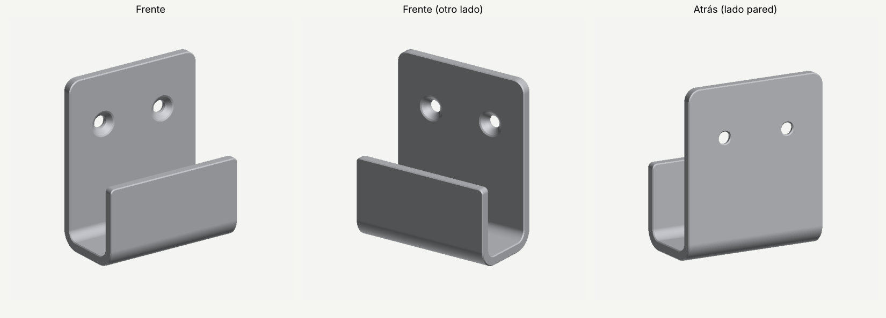

# Soporte / gancho en U

Copia del gancho de acero inoxidable con dos agujeros avellanados, en versión más grande.



| Archivo | Para qué |
|---|---|
| `soporte_gancho.stl` | Para imprimir en 3D |
| `soporte_gancho.step` | Para abrir y editar en Fusion, FreeCAD, SolidWorks, etc. |
| `soporte_gancho.py` | Modelo paramétrico (CadQuery): cambiás las medidas y lo volvés a generar |

## Medidas (mm)

- Ancho: **60**
- Alto de la placa trasera: **70**
- Alto de la pestaña delantera: **34**
- Hueco interior de la U: **24** (profundidad total 32)
- Espesor: **4**
- Agujeros: Ø5 con avellanado Ø10, separados 28, a 49 de la base (para tornillo de 4–4,5 mm de cabeza plana)

## Imprimir

- Imprimilo **acostado sobre el costado** (la cara de 70×32 contra la cama), así las capas siguen la forma de la U y el gancho no se parte en el doblez.
- PETG o PLA+, 4 paredes, 30–40 % de relleno. No necesita soportes.

## Cambiar el tamaño

```bash
pip install cadquery
python soporte_gancho.py
```
Editá los parámetros al principio de `soporte_gancho.py` (ANCHO, ALTO_PLACA, HUECO, ESPESOR...).
